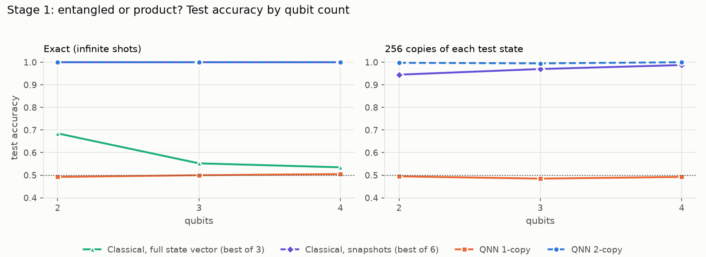
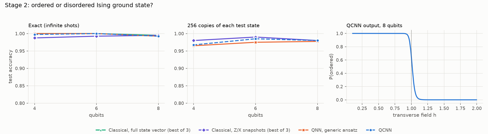
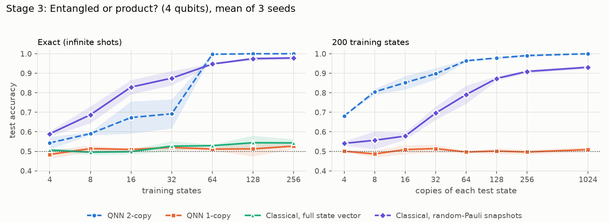
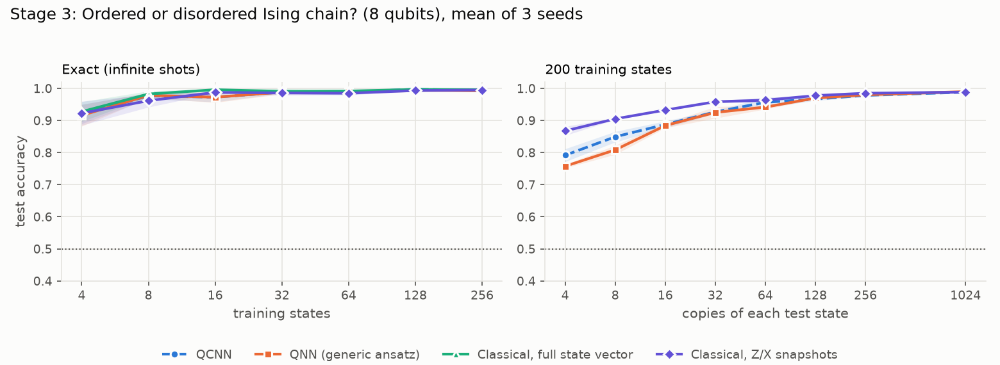
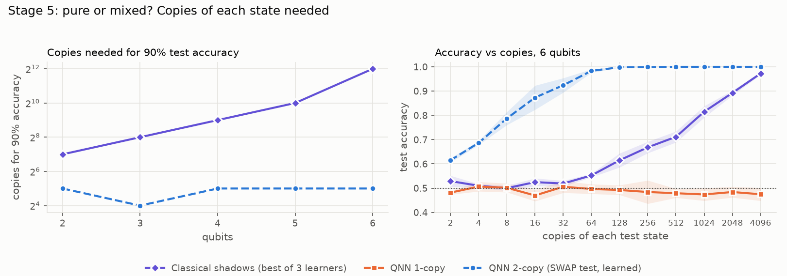
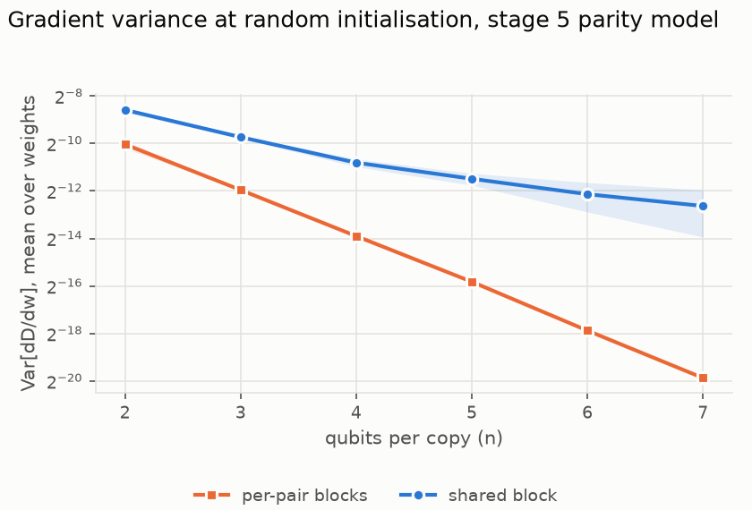
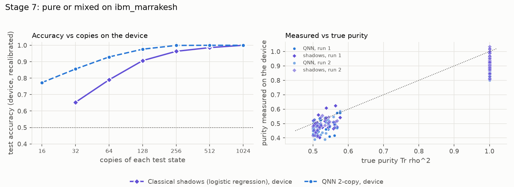
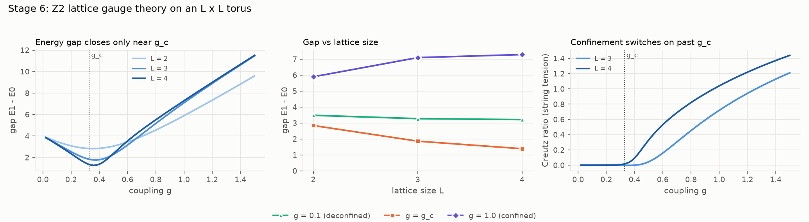
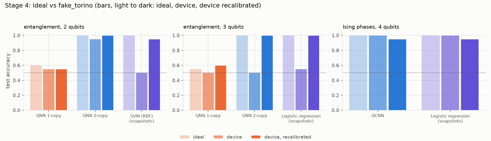
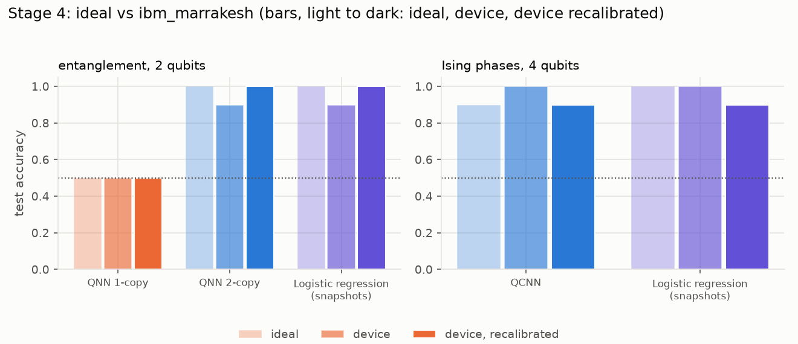

# Entangle

[](https://doi.org/10.5281/zenodo.24148953)

Archived on Zenodo. The badge's concept DOI always resolves to the latest version.
To cite the exact code used in the paper, use v1.0.0:
[10.5281/zenodo.24148954](https://doi.org/10.5281/zenodo.24148954) (commit `c4d3528`).

An honest quantum machine-learning benchmark on data that is **quantum to begin with**.

The [AGI project](https://github.com/H3XY/AGI) squeezed text into 4 rotation angles
and found that a quantum classifier never beat classical models on it. That is
expected: when the data is classical, a classical computer already has all of it.
Here the inputs are quantum states, so a quantum model can act on them directly
while a classical model only ever sees measurement outcomes. That is where quantum
ML has a real argument. This repo tests the argument, with classical baselines
next to every quantum number.

## Results in one paragraph

On detecting entanglement, a **two-copy** QNN learns the SWAP test and is perfect
at 2–4 qubits. A one-copy QNN stays at chance however it is trained, because its
output is linear in the state. Generic classical learners on the full state vector
also do poorly with 200 examples. But the fair classical competitor, a learner on
the same number of random-Pauli measurement snapshots with purity features, is
close behind: 0.94–0.99 against the QNN's 0.995–1.000. On Ising phases everything
works (0.96–1.00) and the QCNN has no edge. On a simulated IBM device, noise breaks
quantum and classical models alike until both are recalibrated on 20 states
prepared on the device. A small run on real IBM hardware (`ibm_marrakesh`) behaved
the same way, with milder noise. On those tasks, which depend on single-qubit
properties, **the quantum benefit is real but small**. It shows up as shot
efficiency: with 64 copies of each test state, the two-copy QNN classifies
entanglement at 0.96, against 0.79 for classical shadows (stage 3).

**On a global property the gap becomes exponential (stage 5).** To tell pure states
from mixed ones at 90% accuracy, the best single-copy classical method needs 128
copies of each state at 2 qubits and 4,096 at 6 qubits. That is roughly double
per added qubit, as theory predicts. The two-copy QNN needs 16–32 copies at
every size (16–64 per seed). **On real hardware** (stage 7, `ibm_marrakesh`, 2
qubits, two independent runs), the two-copy test needs about 48–55 copies for 90%
and classical shadows with the same readout flexibility about 128. That is a ratio
of about 2.5–2.9, and the hierarchical-bootstrap intervals stay above 1. The
noise-free ratio for the same setup is about 6. The device point estimates are
smaller, but with broad uncertainty: the intervals overlap. This is a preliminary
2-qubit illustration. In every stage
the advantage comes from measuring two copies together, not from the trainable
circuit.

**Stage 6** is a toy lattice gauge theory: Z2 gauge theory with one qubit per
link. It shows confinement and an energy gap that closes only at a phase
transition. It is *not* Yang–Mills theory and says nothing toward the
Millennium problem's proof; [docs/YANG_MILLS.md](docs/YANG_MILLS.md) explains
what that problem asks and what is known.

## How it works

```
state-prep circuit ──► |psi>                     (the data: never written down as numbers for the QNN)
                        │
   quantum model:       ├─► trainable circuit ─► measure ─► P(class 1) ─► sigmoid(a(p − b)) ─► label
                        │   (1 copy, 2 copies, or a QCNN)
   classical baselines: ├─► measure in X/Y/Z bases ─► Pauli-expectation & purity estimates ─► sklearn
                        └─► full state vector (2^(n+1) numbers; not available in a real experiment)
```

- **Quantum input, no encoding.** The QNN's only access to a state is running a
  circuit on it and measuring. Training uses the exact output probabilities, the
  infinite-shot limit, computed by a small batched simulator
  ([entangle/sim.py](entangle/sim.py)) with adjoint gradients. Tests check it
  against the full unitary, against parameter-shift gradients, and against
  `qiskit-machine-learning`'s `SamplerQNN` run on the composed prep + model
  circuits.
- **Lessons reused from AGI.** Single-qubit or single-event readout, exact
  probabilities for training, L-BFGS-B on cross-entropy, several random restarts,
  and classical baselines on every table.
- **Lesson that did not transfer: data re-uploading.** You cannot re-upload an
  unknown quantum state, because no-cloning forbids copies. The quantum analogue
  is to ask for more copies of the state, and that is exactly what makes the
  two-copy model work.
- **Same copy budget for everyone.** At test time each model gets the same number
  of copies of each state. The 1-copy QNN uses them as shots. The 2-copy QNN uses
  2 per shot. The classical models use 1 per snapshot.

### Stage 1: entangled or product?

Random 2–4 qubit states come from a circuit of random local rotations and RZZ
entanglers ([entangle/states.py](entangle/states.py)). Product states have every
entangler angle at 0. Entangled states have Meyer–Wallach entanglement Q ≥ 0.2,
where Q is the mean linear entropy of single qubits and equals the squared
concurrence for 2 qubits. Local rotations are random, so both classes have the
same average state, and only entanglement tells them apart.

| Model | What it computes |
|---|---|
| QNN 1-copy | Tr(Mρ) for one trainable observable M. Linear in ρ, so it cannot separate the classes. |
| QNN 2-copy | A trainable 2-qubit block on each pair (qubit i, its copy), with class 1 if any pair reads 11. It can learn Bell-basis measurement: P(singlet on pair i) = (1 − Tr ρᵢ²)/2. |
| Classical, state vector | Logistic regression, RBF SVM and MLP on [Re ψ, Im ψ]. |
| Classical, snapshots | The same learners on all 4ⁿ−1 Pauli expectation estimates plus single-qubit purity estimates, or on the purities alone. |



| Qubits | QNN 1-copy | QNN 2-copy | Classical, state vector (best) | Classical, snapshots (best) |
|---|---|---|---|---|
| 2 | 0.49 / 0.50 | 1.00 / 0.998 | 0.69 | 1.00 / 0.94 |
| 3 | 0.50 / 0.49 | 1.00 / 0.995 | 0.55 | 1.00 / 0.97 |
| 4 | 0.50 / 0.49 | 1.00 / 1.000 | 0.54 | 1.00 / 0.99 |

Each cell is exact / 256 copies per test state, with 200 training and 400 test
states. Full table: [results/stage1_entanglement.md](results/stage1_entanglement.md).

How it scales:
- The 2-copy QNN needs 2n qubits and 8n weights, and stays perfect.
- The full-state classical models get worse as n grows: 2^(n+1) inputs, a highly
  nonlinear target, and only 200 examples. The labels themselves are computed
  classically from the state vector, so this is not "classical can't". It is
  "generic learning from amplitudes is data-hungry". Stage 3 shows how hungry.
- The snapshot models get *better* with n on the purity features, because there
  are more qubits to average over. With all 4ⁿ−1 Pauli features they get worse,
  from too many noisy features.

**How close do classical shadows get?** Very close: this task does *not* separate
quantum from classical. These are means ± std over 5 seeds, at 256 copies per
test state ([results/review_seeds_stage1.md](results/review_seeds_stage1.md)):

| Qubits | QNN 2-copy | Shadows, purity features | Shadows, all Pauli features | Shadows, exact estimates |
|---|---|---|---|---|
| 2 | 0.991 ± 0.006 | 0.951 ± 0.009 | 0.935 ± 0.011 | 1.000 |
| 3 | 0.992 ± 0.004 | 0.975 ± 0.005 | 0.947 ± 0.021 | 1.000 |
| 4 | 0.996 ± 0.005 | 0.988 ± 0.006 | 0.903 ± 0.015 | 1.000 |

With exact (infinite-shot) estimates the classical learners are perfect too.
The label depends only on single-qubit purities, which shadows estimate
efficiently. The gap closes as n grows, from 0.04 at 2 qubits to 0.01 at
4 qubits. The task where the gap opens is stage 5.

### Stage 2: phases of the transverse-field Ising chain

Ground states of H = −Σ ZᵢZᵢ₊₁ − h Σ Xᵢ on open chains of 4, 6 and 8 qubits come
from exact diagonalisation in the even-parity sector, with h uniform in [0.1, 2].
The label is ordered (h < 1) vs disordered (h > 1).

- **QCNN** ([entangle/circuits.py](entangle/circuits.py)): convolution on
  neighbours, then pooling that halves the active qubits, repeated until one is
  left. Weights are shared per layer: 36 weights at 8 qubits.
- **Generic QNN**: the same readout with an unstructured ansatz (64 weights at 8 qubits).
- **Classical**: the same learners on the state vector, or on Z-basis and X-basis
  snapshots, turned into ⟨Zᵢ⟩, ⟨Xᵢ⟩, ⟨ZᵢZⱼ⟩ and ⟨XᵢXⱼ⟩ estimates.



| Qubits | QCNN | Generic QNN | Classical, state vector (best) | Classical, Z/X snapshots (best) |
|---|---|---|---|---|
| 4 | 0.998 / 0.968 | 1.000 / 0.965 | 1.000 | 0.988 / 0.980 |
| 6 | 1.000 / 0.985 | 1.000 / 0.975 | 1.000 | 0.993 / 0.990 |
| 8 | 0.993 / 0.980 | 0.993 / 0.978 | 0.995 | 0.995 / 0.980 |

Each cell is exact / 256 copies. Every model is perfect away from the critical
point (|h − 1| ≥ 0.2). Full table: [results/stage2_phases.md](results/stage2_phases.md).

Ising phases are easy from ordinary Z/X measurements, because the ZZ correlations
give the answer away. The QCNN matches classical models and uses about half the
weights of the generic ansatz, but it has no accuracy advantage. One finding
from the build: the 3-parameter conv and pool units from the Qiskit QCNN tutorial
output exactly 0.5 on these spin-flip-symmetric states, so they cannot learn.
General RY/RZ + CX units fix that, and a regression test covers it.

**What exactly the QCNN is.** It keeps the architecture of Cong, Choi & Lukin
(2019):
- alternating convolution and pooling layers
- weights shared within each layer
- pooling that halves the active qubits each time, down to one readout qubit

The building blocks differ from the Qiskit tutorial in three ways:
- **Convolution unit:** RY RZ on both qubits, CX, then RY RZ on both again
  (8 weights per layer), applied to neighbouring pairs on a ring. It replaces
  the tutorial's 3-parameter unit.
- **Pooling unit:** RY RZ on the source qubit, CX from source to sink, then RY RZ
  on the sink (4 weights per layer). It replaces the tutorial's 3-parameter pool.
- **No mid-circuit measurement.** Pooling is coherent, which gives the same
  output distribution for a single final readout.

So it is a QCNN in architecture, with hardware-efficient units. If a reviewer
reserves "QCNN" for the tutorial's specific units, call it "QCNN-style". Code:
[entangle/circuits.py](entangle/circuits.py), `qcnn_model`, `_conv`, `_pool`.

**How hard is the task?** It is easy. Over 5 seeds, a logistic regression on
*one* exact number already matches every model. Using the mean nearest-neighbour
⟨ZᵢZᵢ₊₁⟩ or the mean ⟨Xᵢ⟩ alone gives 0.994 ± 0.005 at 4 qubits and
0.995 ± 0.006 at 8. All the errors come from states near the critical point.
About 20% of test states have |h − 1| < 0.2:
- On those states the QCNN scores 0.96 ± 0.04 at 4 qubits and 0.97 ± 0.03 at 8.
- On those states classical learners on exact Z/X expectations score
  0.90 ± 0.03 and 0.97 ± 0.01.
- Away from the critical point every model is perfect.

So stage 2 shows that the QCNN *works* on quantum data. It cannot show a quantum
advantage, because there is no headroom. See
[results/review_seeds_stage2.md](results/review_seeds_stage2.md). The same holds
for stage 6, where the mean electric field alone gives 0.998 ± 0.002
([results/review_seeds_stage6.md](results/review_seeds_stage6.md)).

### Stage 3: data efficiency

Accuracy against the number of training states (left, exact) and against the
number of copies of each test state (right, 200 training states). Each point is
the mean of 3 independent datasets, and the band is ±1 std.
Full tables: [results/stage3_efficiency.md](results/stage3_efficiency.md).



**Entanglement (4 qubits).** This is where the two-copy QNN earns its keep.
Measured per copy of the state, it is far more efficient than classical
snapshots:

| Copies per test state | 4 | 16 | 64 | 256 | 1024 |
|---|---|---|---|---|---|
| QNN 2-copy | 0.68 | 0.85 | 0.96 | 0.99 | 1.00 |
| Classical, random-Pauli snapshots | 0.54 | 0.58 | 0.79 | 0.91 | 0.93 |

The reason: a Bell-pair measurement on two copies reads out a purity deficit in
one shot. Classical shadows must estimate ⟨X⟩², ⟨Y⟩² and ⟨Z⟩² from shots split
across random bases. Against training states, though, the classical snapshot
model learns *faster*: 0.83 vs 0.67 at 16 states. The QNN's non-convex training
only reliably finds the SWAP test from about 64 states upward. The 1-copy QNN and
the full-state classical models stay near chance even at 256 training states.



**Ising phases (8 qubits).** All models reach about 0.92 from just 4 training
states and about 0.99 from 32. With few shots, classical Z/X snapshots do
better: 0.87 vs the QCNN's 0.79 at 4 copies. The ZZ correlations are directly
measurable, while the QCNN's single readout bit is a noisier summary. The curves
meet by 256 copies.

### Stage 5: a global property (pure or mixed?)

Stages 1–3 use labels that depend on single-qubit properties, which classical
shadows estimate cheaply. Stage 5 tests the case where theory proves an
exponential separation (Huang, Kueng & Preskill 2021; Chen, Cotler, Huang & Li
2022): telling **Haar-random pure states** from **random rank-2 mixed states**
(Tr ρ² between 0.5 and 0.58), on 2–6 qubits. Both classes average to the
maximally mixed state, and their single-qubit marginals become alike as n grows.
Only the purity of the whole state separates them.

- **QNN 2-copy (parity).** The same pairwise blocks as stage 1, with class 1 if an
  *odd* number of pairs read 11. The SWAP of the whole register is the product of
  the pair SWAPs, so with Bell-basis blocks P(class 1) = (1 − Tr ρ²)/2 (checked in
  `tests/`).
- **Classical shadows.** Random-Pauli snapshots turned into an unbiased estimate of
  the *global* purity, plus single-qubit purities, with the best of 3 learners.
  This is the best known single-copy strategy. A rank-4 factorisation makes the
  estimator about 6ⁿ·4n operations instead of S²·n.
- Mixed states are handled as purifications (ρ = AA†) in the simulator and the
  snapshot sampler.



Copies of each test state needed for 90% test accuracy (200 training states,
mean of 3 seeds):

| Qubits | 2 | 3 | 4 | 5 | 6 |
|---|---|---|---|---|---|
| QNN 2-copy (learned SWAP test) | 32 | 16 | 32 | 32 | 32 |
| Classical shadows (best of 3) | 128 | 256 | 512 | 1,024 | 4,096 |

At 6 qubits and 64 copies, the QNN scores 0.98 and classical shadows 0.55. The
one-copy QNN is at chance (0.47–0.52) at every size and every copy count.
Full tables: [results/stage5_purity.md](results/stage5_purity.md).

The table uses one definition of copies needed: the smallest power of 2 at which
the **mean** accuracy over the 3 seeds reaches 90%. Per seed, each run's own
smallest power of 2 is:

| Qubits | 2 | 3 | 4 | 5 | 6 |
|---|---|---|---|---|---|
| QNN 2-copy, per seed | 64, 16, 16 | 16, 16, 16 | 32, 16, 16 | 16, 32, 16 | 64, 32, 16 |
| Classical shadows, per seed | 128, 128, 128 | 256, 256, 256 | 512, 512, 512 | 2048, 1024, 2048 | 2048, 4096, 4096 |

The QNN needs 16–64 copies at every size. Classical shadows need 128–4,096,
growing with n. The two ranges never overlap. The grid can sit below the per-seed
median when the mean only just crosses 90%: at 5 qubits the mean is 0.901 at
1,024 copies. See
[results/review_seeds_stage5.md](results/review_seeds_stage5.md).

**Model selection without the test set.** Picking the best learner on the test set
flatters the classical side. [review_selection.py](review_selection.py) instead
chooses the learner *and* its hyperparameters on a 50-state validation split of
the training states. The grid covers logistic regression (5 values of C), RBF SVM
(4 C × 3 γ) and MLP (3 α). The chosen model is then evaluated once on test.
These are copies for 90%, grid definition, with per seed in brackets, on fresh
snapshot draws:

| Qubits | 2 | 3 | 4 | 5 | 6 |
|---|---|---|---|---|---|
| Validated selection | 128 (128, 128, 128) | 256 (256, 256, 256) | 512 (512, 1024, 512) | 2048 (2048, 2048, 1024) | 4096 (4096, 4096, 4096) |
| Old rule (best on test), same draws | 128 | 256 | 512 | 1024 | 4096 |

Only n = 5 changes, from 1,024 to 2,048, so the honest classical threshold is the
same or higher. All three learners' curves are in
[results/review_selection.md](results/review_selection.md).

**Training: a measured barren plateau.** With a separate trainable block per
pair, training from a random start works up to 4 qubits. At 5 qubits it failed
in one of three seeds: 0.555, 1.000 and 1.000, so 0.85 ± 0.26. We measured the
cause directly instead of inferring it ([review_gradients.py](review_gradients.py)).
The method:
- Draw random weights from the same distribution training starts from.
- Compute exact gradients of the class signal D = mean P(class 1 | mixed) −
  mean P(class 1 | pure), over 100 draws × 3 data seeds.



| Qubits per copy | 2 | 3 | 4 | 5 | 6 | 7 |
|---|---|---|---|---|---|---|
| Per-pair blocks: Var[∂D/∂w] | 9.5e-4 | 2.5e-4 | 6.6e-5 | 1.7e-5 | 4.2e-6 | 1.0e-6 |
| Shared block: Var[∂D/∂w] | 2.6e-3 | 1.2e-3 | 5.6e-4 | 3.5e-4 | 2.2e-4 | 1.6e-4 |

- **Per-pair blocks:** the gradient variance falls by a factor of 3.9 per added
  qubit. The log2 slope is −1.97, with per-seed slopes −1.95, −1.94 and −2.01.
  Its 95% interval is [−2.06, −1.87] over seeds and [−1.98, −1.95] by bootstrap
  over draws.
- **Shared block:** the variance falls by a factor of only 1.7 per qubit, with
  8 weights at every size. The slope is −0.80, with per-seed slopes −1.05, −0.76
  and −0.79. Its interval is [−1.26, −0.47] over seeds and [−1.01, −0.69] by
  bootstrap. At 7 qubits the shared model's gradients are more than 100 times
  larger.
- **What this does and doesn't show.** This is exponential-like decay over the
  measured range (n = 2–7), consistent with a barren-plateau mechanism for the
  global parity readout. Six sizes do not establish the asymptotic rate.
- **No starting point had a gradient norm below 10⁻³** at these sizes. The
  failure at 5 qubits is small gradients plus a rugged landscape, not exactly
  flat starts.

Full table: [results/review_gradients.md](results/review_gradients.md).

Two fixes work:
- sharing one block across all pairs (1.00 at 5 qubits from scratch)
- training that block at 2 qubits and transferring it to larger n (1.00 at every
  size, with 30 fine-tuning steps)

The transferred model is the one in the table. So the exponential advantage at
*measurement* time comes with a *training* hazard that has to be designed around.

### Stage 7: the purity test on real hardware

Stage 7 runs the stage 5 experiment at 2 qubits on `ibm_marrakesh`
([stage7_hardware_purity.py](stage7_hardware_purity.py)). That turns the headline
comparison into a hardware result.

**Setup:**
- **States.** A rank-2 mixed state needs an ancilla, so every state is prepared
  as a 3-qubit purification and the ancilla is never measured. Pure states use
  the same 3-qubit preparation with the ancilla in |0⟩. Both classes compile to
  exactly 7 CZ gates, so circuit depth does not reveal the label.
- **2-copy QNN.** Two preparations on 6 qubits, then the trained shared-block
  parity model on the 4 system qubits: 512 shots per state.
- **Classical shadows.** The same preparation, measured in all 9 X/Y/Z bases on
  the system qubits at 113 shots each. The snapshots give the global and local
  purity estimates.
- **Data.** 60 test states and 20 calibration states, balanced.
- **Runs.** Two independent runs on the same states and the same physical
  qubits: 4, 6, 5 for copy 1 and 8, 17, 7 for copy 2 (`--layout`).
- **Records.** A calibration snapshot of those qubits is saved with each run.
- **Comparison.** FakeMarrakesh, the noise model of the same device, running
  the *identical* transpiled circuits. Those are the ISA circuits of the real jobs,
  downloaded from IBM along with the raw counts
  ([fetch_ibm_results.py](fetch_ibm_results.py), `results/ibm_raw/`). Its
  per-qubit calibration is compared with the real device's in
  [results/review_calibration.md](results/review_calibration.md).

At 1,024 copies, every model is at 0.98–1.00 on the device, and 1.00 after
recalibration. So the comparison is copies needed. We subsample the device
counts to fewer shots (20 resamples per point, readout recalibrated):



| Copies of each test state | 16 | 32 | 64 | 128 | 256 | 1024 |
|---|---|---|---|---|---|---|
| QNN 2-copy, ibm_marrakesh | 0.77 | 0.86 | 0.93 | 0.98 | 1.00 | 1.00 |
| Classical shadows, ibm_marrakesh | – | 0.65 | 0.79 | 0.91 | 0.96 | 1.00 |
| QNN 2-copy, FakeMarrakesh | 0.80 | 0.90 | 0.95 | 0.99 | 1.00 | 1.00 |
| Classical shadows, FakeMarrakesh | – | 0.68 | 0.82 | 0.92 | 0.97 | 0.99 |

These are means of 2 runs; the run-to-run std is at most 0.03. Classical shadows
need at least 18 copies, 2 per basis setting.

**Copy accounting.** "c copies" means c state preparations for both methods.
- The QNN uses c/2 shots of a circuit that holds 2 copies.
- Shadows use ⌊c/9⌋ shots in each of the 9 bases.
- On the device each state got 1,024 preparations for the QNN and 1,017 for
  shadows.
- Smaller c are drawn **without replacement** from those shots.

**Recalibration.** The 20 calibration states are drawn independently of the 200
training states (seed 2 vs 0) and of the test states (seed 1). None coincides
with any of them: the smallest ‖ρ − ρ′‖ is 0.32. They are prepared in the same
job as the test states. What gets refitted on them:
- **QNN:** a logistic regression on its single output p (2 parameters).
- **Shadows, equal flexibility:** a logistic regression on the single global-purity
  estimate (2 parameters).
- **Shadows, 3 features:** global and both local purities (4 parameters).

**Results** ([review_purity_hw.py](review_purity_hw.py),
[results/review_purity_hw.md](results/review_purity_hw.md)). That file gives, per
run and per copy count:
- accuracy before and after recalibration
- a 95% bootstrap interval over the 60 test states
- uncertainty over which states calibrate, by bootstrapping the 20 calibration
  states and by re-splitting all 80 device states 20/60

Copies for 90%, from log2-linear interpolation of the recalibrated curve, with
bootstrap 95% intervals:

| Device, run | QNN 2-copy | Shadows, global purity (2 params) | Ratio | Shadows, 3 features (4 params) |
|---|---|---|---|---|
| ibm_marrakesh, run 1 | 45 [33, 56] | 121 [102, 157] | 2.7 [2.0, 4.0] | 163 [126, 201] |
| ibm_marrakesh, run 2 | 53 [42, 69] | 117 [103, 138] | 2.2 [1.6, 2.9] | 119 [105, 143] |
| FakeMarrakesh, run 1 | 35 [29, 42] | 112 [98, 134] | 3.2 [2.6, 4.2] | 121 [104, 153] |
| FakeMarrakesh, run 2 | 40 [32, 47] | 110 [95, 134] | 2.7 [2.2, 3.6] | 125 [104, 160] |

**Findings:**
- **On the device the 2-copy test needs fewer copies** than classical shadows with
  equal readout flexibility. That holds in both runs, under both analyses below.

**Uncertainty, propagated in full** ([review_purity_boot.py](review_purity_boot.py),
[results/review_purity_boot.md](results/review_purity_boot.md)). The intervals
above treat the 30 shot subsamples as independent, although they overlap, and they
keep the calibration fit fixed. The hierarchical bootstrap instead works on each
job separately, since the two jobs are the only independent runs. Each of its
1,000 replicates:
1. resamples the test and calibration states
2. resamples each state's raw device shots with replacement
3. subsamples c copies without replacement, for calibration and test states alike
4. refits the 2-parameter recalibration
5. re-interpolates the thresholds

The noise-free reference applies the same procedure to the same 80 states, with
shots drawn from the exact outcome distributions.

| | QNN copies for 90% | Shadow copies for 90% | Ratio | P(ratio < 1) | P(device ratio < noise-free ratio) |
|---|---|---|---|---|---|
| Noise-free, same states and design | 16 [8, 40] | 108 [60, 181] | 6.3 [2.5, 14.9] | 0.000 | – |
| ibm_marrakesh run 1 | 48 [24, 91] | 128 [64, 256] | 2.9 [1.3, 7.1] | 0.005 | 0.87 |
| ibm_marrakesh run 2 | 55 [27, 108] | 128 [80, 256] | 2.5 [1.1, 6.3] | 0.017 | 0.90 |

Values are medians with 95% intervals. The last column compares each device
replicate with each noise-free replicate, so it allows for uncertainty on both
sides. The 95% interval of log2(device ratio / noise-free ratio) is [−2.8, 0.8]
for run 1 and [−3.1, 0.6] for run 2.

- **Device ratio above 1:** P(ratio < 1) is at most 0.017 per job. So the 2-copy
  test needs fewer copies on the device too.
- **Smaller than noise-free, but not significantly:** the device point estimates
  are below the noise-free ratio, but both intervals include it.
- **Calibration budget:** the primary analysis calibrates at the same c as the
  test states. Calibrating on the full 1,024 copies instead gives ratios of 3.1
  [1.3, 6.9] and 3.0 [1.3, 7.4].
- **Stage 5 cross-check:** the stage 5 simulation at n = 2, through the same
  interpolation instead of the power-of-2 grid, gives 18.5 vs 97.7 copies, a
  ratio of 5.3. The "32 vs 128 = 4" quoted elsewhere is a grid artefact.
- **Noise costs the QNN more.** It needs about 48–55 copies on the real device,
  35–40 on FakeMarrakesh and about 16 in noise-free simulation of the same setup. The
  6-qubit two-copy circuit has about 19 CZ after routing, against 7 for a shadow
  circuit, which is a plausible explanation; we did not isolate the cause. Treat
  this as a preliminary 2-qubit illustration with 2 runs.
- **Recalibration barely matters here:** before and after agree within about
  0.03 at every copy count.
- **FakeMarrakesh understates the noise for these compiled circuits.** On
  identical circuits and qubits, the QNN's mean output shift (device minus exact
  P(class 1)) is +0.038 and +0.041 on the real device, against +0.022 and +0.019
  on FakeMarrakesh.
- **Pure states shift more** (+0.05 to +0.06) than mixed ones (+0.02): noise
  makes everything look more mixed.
- **Both methods track the true purity.** The QNN's 1 − 2P correlates with the
  true Tr ρ² at r = 0.986 in both runs, and the shadow estimate at r = 0.975 and
  0.981. Both read low, by 0.09–0.10 for the QNN and 0.06–0.07 for shadows.

At 2 qubits, single-copy shadows are cheap, so the gap is a constant factor. The exponential gap in stage 5 needs more qubits, which means deeper
preparation circuits than this device can run cleanly. Results:
[results/stage7_hardware_purity_ibm.md](results/stage7_hardware_purity_ibm.md),
[results/review_hardware.md](results/review_hardware.md).

### Stage 6: a toy lattice gauge theory (not Yang–Mills)

Z2 lattice gauge theory in 2+1 dimensions on an L × L torus, one qubit per link
(8, 18 and 32 qubits for L = 2, 3, 4) ([entangle/gauge.py](entangle/gauge.py)):

    H = − Σ_plaquettes Z Z Z Z − g Σ_links X

Physical states obey Gauss's law at every vertex. Spectra come from Wegner
duality, an exact map to the 2D quantum Ising model with one spin per
plaquette. The tests check it against direct simulation of the link qubits.
The infinite-lattice transition is at g_c ≈ 0.3285.



| | L = 2 | L = 3 | L = 4 |
|---|---|---|---|
| Gap at g = 0.1 (deconfined) | 3.48 | 3.27 | 3.21 |
| Gap at g = 1.0 (confined) | 5.90 | 7.10 | 7.29 |
| Minimum gap (near g_c) | 2.83 | 1.77 | 1.27 |
| Creutz ratio (string tension) at g = 1.0 | – | 0.72 | 1.04 |

- **Both phases have a gap** that settles as the lattice grows.
- **Near the transition the gap shrinks** with every size, consistent with it
  closing in infinite volume.
- **Confinement switches on past g_c.** The Creutz ratio, an estimate of the
  string tension, turns positive there, and Wilson loops decay with the
  enclosed area.
- **Phase classification** of the 8-qubit ground states works for the QCNN
  (1.00 exact, 0.96 with 256 copies) and for classical learners on Z/X
  snapshots of plaquettes and electric fields (0.97–0.98) alike. As with Ising,
  there is no quantum edge.

Full tables: [results/stage6_gauge.md](results/stage6_gauge.md).

The connection to Yang–Mills is conceptual only. A mass gap is not automatic:
here it closes at a phase transition. The conjecture for 4D SU(N) is that no
such transition separates the provably gapped strong-coupling regime from the
continuum. Z2 has no gluons, no asymptotic freedom and no continuum limit, and
every finite lattice has a gap anyway. See
[docs/YANG_MILLS.md](docs/YANG_MILLS.md) for the problem statement, the known
rigorous results, and why no computation here amounts to progress on a proof.

### Stage 4: hardware

Each test state is prepared on the device, then classified there.
- **Quantum models:** the prep circuit (once per copy) is followed by the trained
  model circuit.
- **Classical baseline:** the prep circuit is measured in fixed Pauli bases: all
  3ⁿ settings for entanglement, all-Z and all-X for Ising.

Models are trained in simulation. Noise shifts every model's outputs. For
example, noise makes product states look mixed, which reads as "entangled". So
the script also prepares 20 labelled calibration states on the device. The
quantum models refit only their 2-parameter readout calibration on them, and the
classical models are refit on the device snapshots.



Local noisy simulation of `ibm_torino` (`FakeTorino`), 20 test states per task,
1024 copies per state per model:

| Task | QNN 1-copy | QNN 2-copy / QCNN | Classical, snapshots (best) |
|---|---|---|---|
| Entanglement, 2 qubits | 0.60 → 0.55 → 0.55 | 1.00 → 0.95 → 1.00 | 1.00 → 0.50 → 0.95 |
| Entanglement, 3 qubits | 0.55 → 0.50 → 0.60 | 1.00 → 0.50 → 1.00 | 1.00 → 0.55 → 1.00 |
| Ising phases, 4 qubits | – | 1.00 → 1.00 → 0.95 | 1.00 → 1.00 → 0.95 |

Each cell reads ideal → device → device recalibrated. The classical column takes
the best learner in each column. Without recalibration, the classical purity
models call every state "entangled", and so does the 6-qubit two-copy circuit.
Noise lowers measured purity exactly the way entanglement does. Twenty labelled
device states fix both. See
[results/stage4_hardware_fake.md](results/stage4_hardware_fake.md). With 20 test
states, one state is 0.05 of accuracy, and reruns can differ by about that much.
**Real hardware: `ibm_marrakesh`** (156-qubit IBM Heron, open plan, 8–9 Nov 2026).
A small run: 10 test states and 10 calibration states per task, 512 copies of
each state per model, 280 circuits in 5 jobs:

```bash
python stage4_hardware.py --qubits-entanglement 2 --states 10 --calibrate 10 --copies 512
```



| Task | QNN 1-copy | QNN 2-copy / QCNN | Classical, snapshots (best) |
|---|---|---|---|
| Entanglement, 2 qubits | 0.50 → 0.50 → 0.50 | 1.00 → 0.90 → 1.00 | 1.00 → 0.90 → 1.00 |
| Ising phases, 4 qubits | – | 0.90 → 1.00 → 0.90 | 1.00 → 1.00 → 0.90 |

Each cell reads ideal → device → device recalibrated. See
[results/stage4_hardware_ibm.md](results/stage4_hardware_ibm.md).

- The real device was gentler than the FakeTorino noise model. Without any
  recalibration, the 2-copy QNN and the classical snapshot models both kept
  0.90 on entanglement, where the fake device dropped the classical models to
  0.50.
- Recalibrating restored entanglement to 1.00 for both. On Ising it *lowered*
  accuracy by one or two states, because refitting on only 10 labelled states
  can overfit.
- With 10 test states, one state is 0.10 of accuracy. These numbers show that
  the pipeline works end to end on hardware, and that quantum and classical
  models degrade similarly. They are too small to rank the models.

**Larger hardware runs (9 Nov 2026).** We ran each task twice on the same 40
test states (balanced) plus 16 calibration states, with a fixed `seed_transpiler`
so both runs use the same physical qubits. The 1-copy QNN was left out, since it
is at chance by construction. Each run is 1,456 circuits in 4 jobs and costs
37 s of quantum time:

```bash
python stage4_hardware.py --backend ibm_marrakesh --qubits-entanglement 2 --states 40 --calibrate 16 \
    --copies 512 --skip-one-copy --tag ibm_run1 --run-label "run 1"
```

| Task | Model | Ideal | ibm_marrakesh | Recalibrated | FakeMarrakesh | FakeMarrakesh, recalibrated |
|---|---|---|---|---|---|---|
| Entanglement, 2 qubits | QNN 2-copy | 1.000 | 0.800 ± 0.035 | 0.988 ± 0.018 | 0.962 ± 0.018 | 0.975 ± 0.000 |
| Entanglement, 2 qubits | Classical snapshots (best) | 1.000 | 0.938 ± 0.018 | 0.975 ± 0.000 | 0.988 ± 0.018 | 1.000 ± 0.000 |
| Ising, 4 qubits | QCNN | 0.950 | 0.925 ± 0.035 | 0.925 ± 0.035 | 0.988 ± 0.018 | 0.975 ± 0.035 |
| Ising, 4 qubits | Classical snapshots (best) | 0.975 | 0.962 ± 0.018 | 0.962 ± 0.018 | 0.975 ± 0.000 | 0.950 ± 0.035 |

The FakeMarrakesh columns replay the identical transpiled circuits of the real
jobs, with the same shots.

Values are mean ± std over 2 runs. With 80 pooled test predictions, the Wilson
95% interval on 0.95 is about [0.88, 0.98]. So no model ranking inside a task is
significant. Full table with intervals, per-qubit calibration, job IDs and billed
seconds: [results/review_hardware.md](results/review_hardware.md).

- **Without recalibration the 2-copy QNN loses most** (0.80, against 0.94 for
  classical snapshots). Its 4-qubit circuit picks up a positive output shift of
  +0.028 and +0.032 per run, which pushes product states over the threshold.
  Sixteen labelled device states restore it to 0.99.
- **The fake backend understates this.** Running the identical transpiled
  circuits on the same qubits, FakeMarrakesh gives the 2-copy circuit a shift of
  +0.015 to +0.016, against +0.028 to +0.032 on the device. For the 4-qubit QCNN,
  real and fake agree: −0.007 to −0.009 on both.
- **Ising behaves as in simulation:** every model scores 0.90–0.98 on the device.

## Usage

Requires Python 3.11+ (developed on 3.12). Everything runs locally on CPU, and
nothing is downloaded beyond the pip packages.

```bash
python3.12 -m venv .venv
source .venv/bin/activate
pip install -r requirements.txt

python stage1_entanglement.py          # ~15 s   2-4 qubit entanglement classifier
python stage2_phases.py                # ~2 min  4-8 qubit Ising phases, QCNN
python stage3_efficiency.py            # ~9 min  accuracy vs training states and vs shots
python stage4_hardware.py --fake       # ~1 min  IBM device noise model, no account needed
python stage5_purity.py                # ~35 min pure vs mixed, 2-6 qubits, copies-needed scaling
python stage6_gauge.py                 # ~1 min  Z2 lattice gauge theory: gap, confinement, phases
python stage7_hardware_purity.py --fake  # ~1 min pure vs mixed on the FakeMarrakesh noise model
python review_seeds.py --stage 1       # ~2 min  5-seed uncertainty (also --stage 2, 5, 6)
python review_gradients.py             # ~20 min gradient variance vs qubits (barren-plateau check)
python review_hardware.py              # summary of every hardware run, real vs fake
python fetch_ibm_results.py --replay FakeMarrakesh  # raw counts + ISA circuits of logged jobs; replay on fake
python review_purity_hw.py             # ~3 min  stage 7 recalibration, copy accounting, intervals
python review_selection.py             # ~3 min  stage 5 shadows with validation-based model selection
python review_purity_boot.py           # ~6 min  stage 7 thresholds: hierarchical bootstrap per job
python -m pytest -q tests              # correctness checks
./security/audit_deps.sh               # pip-audit scan -> results/dependency_audit.md
```

Each script takes `--help`. Examples: `--qubits 2 3`, `--copies 64`, `--seeds 5`,
`--task phases`.

### Real IBM Quantum hardware

Create an account at https://quantum.cloud.ibm.com, then either export your key:

```bash
export IBM_QUANTUM_TOKEN="<your API key>"
export IBM_QUANTUM_INSTANCE="<your instance CRN>"   # optional
```

or save it once with
`QiskitRuntimeService.save_account(channel="ibm_quantum_platform", token=..., set_as_default=True)`.
**Never commit tokens.** `.gitignore` excludes `.env` files and `qiskit-ibm.json`.

```bash
python stage4_hardware.py                              # least busy device; asks before submitting
python stage4_hardware.py --backend ibm_torino --states 10 --copies 512 --task entanglement
```

Results go to `results/stage4_hardware_ibm.*` (or `--tag`). The full default run is about
1,720 circuits; the small run above is 280.

Before every real-device job the scripts read the account's remaining quantum time
(`QiskitRuntimeService().usage()`) and refuse to submit if the job's estimated cost
(about 0.26 ms per shot plus 3 s per job, measured on `ibm_marrakesh`) would leave
less than `--floor` seconds (default 125), or take the run past `--cap` (default 170).
Every billed job is logged to `results/ibm_jobs.json` with its ID, time and quantum
seconds.

## Repo layout

```
stage1_entanglement.py ... stage7_hardware_purity.py    one CLI per stage
review_*.py, fetch_ibm_results.py   robustness checks (uncertainty, gradients, model selection, hardware)
docs/YANG_MILLS.md       the Millennium problem: statement, known results, what stage 6 does not show
entangle/
  states.py      product/entangled states, Meyer-Wallach Q, concurrence, Ising ground states, pure/mixed states
  circuits.py    1-copy QNN, 2-copy QNN, QCNN, generic ansatz (tied weights, readout masks)
  sim.py         batched state-vector simulator with adjoint gradients
  qnn.py         training (exact probabilities, L-BFGS-B, readout calibration), mixed-state batches, shots
  measure.py     Pauli snapshots, feature estimates, shadow global-purity estimator, measurement circuits
  classical.py   logistic regression / RBF SVM / MLP baselines
  gauge.py       Z2 lattice gauge theory: lattice, Wegner-dual solver, Wilson loops, link-qubit states
  ibm.py         IBM Runtime access: credentials, quantum-time budget guard, job log, calibration snapshots
  report.py      JSON, Markdown and chart output
tests/           simulator vs full unitary, adjoint vs parameter shift, vs SamplerQNN, physics checks
security/        pip-audit dependency scan
results/         JSON, Markdown tables and charts for every stage, dependency audit
```

## Limitations

- **Small systems.** We test 2–4 qubits for entanglement (8 with two copies),
  4–8 for Ising and 2–6 for purity (12 with two copies), all simulated exactly.
  The exponential trend in stage 5 is measured over five sizes. It matches the
  theory, but it is not a proof of scaling, which the cited papers provide.
- **Stage 5 states are Haar-random,** chosen because the theory is cleanest for
  them. Preparing Haar-random states needs circuits whose depth grows
  exponentially, so only the 2-qubit case has run on hardware (stage 7). A larger
  hardware version would use shallow random circuits (approximate designs).
- **The two-copy model is physics-informed.** Its pairwise blocks and its
  readouts ("any pair reads 11", "an odd number of pairs read 11") are designed
  so that the SWAP test is expressible. Training finds it, with weight sharing or
  transfer for the global readout. A generic ansatz on 2n qubits might not.
- **Two copies at once** need both copies in quantum memory together. That is
  harder than measuring copies one at a time, which is all the classical
  baseline needs.
- **Training is noise-free.** Models are trained on exact probabilities and only
  tested with shots and noise. On the device they need recalibration on a few
  labelled states, and so do the classical baselines.
- **Classical baselines are generic** (sklearn), but picking the best of them on
  the test set flatters the classical side. A hand-written classical estimator
  can compute Q from the state vector exactly, and that is how the labels are made.
- **Ising states are loaded with `StatePreparation`.** That is exact, but it is
  not how a real experiment would make them. For stage 4 we keep the chain at 4
  qubits so the circuits stay shallow.
- **Qiskit is pinned below 2**, as in AGI. `SamplerQNN`'s exact reference
  `Sampler` (used in the tests) is removed in Qiskit 2.
- **Hardware numbers are small-sample.** Stage 4 has 40 test states × 2 runs per
  task, and stage 7 has 60 × 2. With these sizes, accuracy differences under
  about 0.05 are not significant (Wilson intervals in
  [results/review_hardware.md](results/review_hardware.md)). Only small sizes
  have run on a real device: 2-qubit entanglement and purity, and the 4-qubit
  Ising chain. Two runs give one estimate of run-to-run spread, not a
  distribution.
- **Seed uncertainty.** Stages 1, 2 and 6 report one seed in their own tables.
  [review_seeds.py](review_seeds.py) reruns them over 5 seeds (results in
  `results/review_seeds_stage*.md`), and the stds there are small, at most 0.04.

## License

MIT
